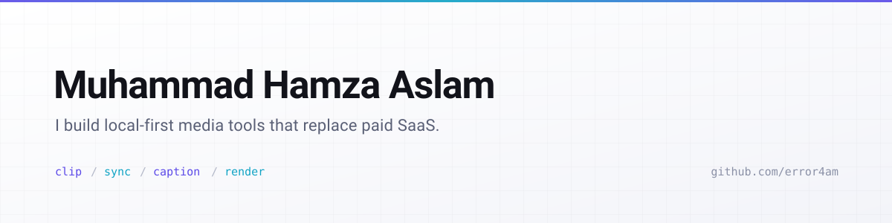

  <picture>
    <source media="(prefers-color-scheme: dark)" srcset="assets/banner-dark.svg">
    
  </picture>

 

I build tools that run on your machine and do what a paid SaaS does — clip a live stream, sync a watch party, burn captions, render a video. No cloud, no API keys, no subscription.

 

## Now building

**[ytclipper](https://github.com/error4am/ytclipper)** — clips a YouTube live stream *while it is still streaming*. Records into a rolling buffer, watches for hype (loud moments + chat spikes), and saves `.mp4` clips that include the seconds *before* the moment. Local captions, 9:16 export for Shorts/Reels, live HLS dashboard.
Python · ~4,300 lines across 17 modules · fully offline

**[tempass](https://github.com/error4am/tempass)** — a private, two-person YouTube watch party. Rooms, invite links, live presence, chat, and clock-synced playback so both players stay aligned.
TypeScript · monorepo · 13 test suites · [live demo](https://tempass.vercel.app)

 

## Shipped

| Project | What it is | Status |
|---|---|---|
| [**ytclipper**](https://github.com/error4am/ytclipper) | Live-stream clipping engine with hype detection and vertical export | `in progress` |
| [**tempass**](https://github.com/error4am/tempass) | Private YouTube watch-party app for two | [live](https://tempass.vercel.app) |
| [**photo-museum**](https://github.com/error4am/photo-museum) | First-person 3D photography gallery in Three.js, 33 frames, procedurally built | [live](https://photo-museum-bice.vercel.app) |
| [**land-converter**](https://github.com/error4am/land-converter) | Pakistani land-unit calculator — Kanal, Marla, Acre, Bigha, state-specific | [live](https://land-converter-navy.vercel.app) |
| [**dairy-farm**](https://github.com/error4am/dairy-farm) | Full-stack dairy management — animals, milk yield, breeding, health, staff, finances. React + Node + SQLite with migrations, backups and validation | `full-stack` |
| [**errorify**](https://github.com/error4am/errorify) | Minimal AI chat UI with a hardened Express proxy — rate limiting, CORS allowlist, local-only history | [live](https://errorify.vercel.app) |

 

## Toolbox

`Python` · `TypeScript` · `React` · `Node` · `Three.js / WebGL` · `ffmpeg` · `Whisper` · `WebSockets` · `Vite` · `SQLite`

 

## How I work

- **Local-first.** If it can run offline, it should. Your files never leave your machine.
- **Finish the demo.** Every project ships with something clickable, not just a README.
- **Read the constraint, not the hype.** No API key, no GPU, no budget usually means a better design.

 

[All repositories](https://github.com/error4am?tab=repositories) · Open to interesting problems in media tooling and real-time video.
