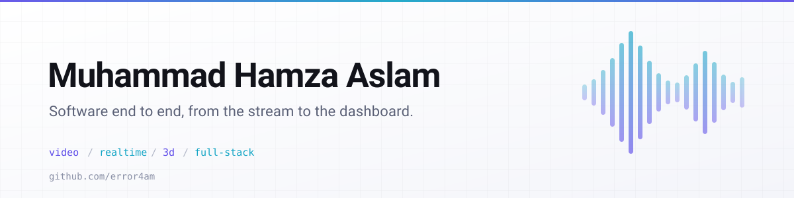

  <picture>
    <source media="(prefers-color-scheme: dark)" srcset="assets/hero-dark.svg">
    
  </picture>

 

Six things I've built and finished enough to show. Different domains, same approach: pick a real problem, use less, ship it working. Most of it runs locally with no API keys and no cloud bill.

 

**[ytclipper](https://github.com/error4am/ytclipper)** — clips a YouTube live stream while it's still streaming. Rolling buffer, hype detection from audio + chat, local captions, 9:16 export.
Python · ~4,300 lines · no API keys

**[tempass](https://github.com/error4am/tempass)** — two-person YouTube watch party: rooms, invite links, live presence, chat, clock-synced playback.
TypeScript · 13 test suites · [live ↗](https://tempass.vercel.app)

**[dairy-farm](https://github.com/error4am/dairy-farm)** — dairy management built for a working farm: animals, milk yield, breeding, health, staff and finances.
React · Node · SQLite · migrations, backups, validation

**[photo-museum](https://github.com/error4am/photo-museum)** — first-person 3D gallery in Three.js with 33 frames, built procedurally. No Blender, no game engine.
JavaScript · WebGL · [live ↗](https://photo-museum-bice.vercel.app)

**[land-converter](https://github.com/error4am/land-converter)** — Pakistani land-unit calculator: Kanal, Marla, Acre, Bigha, with state-specific conversions.
HTML/JS · SEO-first · [live ↗](https://land-converter-navy.vercel.app)

**[errorify](https://github.com/error4am/errorify)** — AI chat UI on a hardened Express proxy: rate limits, CORS allowlist, history kept local.
React · Express · [live ↗](https://errorify.vercel.app)

 

## Toolbox

`Python` · `TypeScript` · `React` · `Node` · `Three.js / WebGL` · `ffmpeg` · `Whisper` · `WebSockets` · `SQLite` · `Vite`

 

## How I work

- **Local-first.** If it can run on your machine, it should. Your files don't leave it.
- **Finish the demo.** Every project here has something you can open and use, not just a README.
- **Constraints are the design.** No API key, no GPU, no budget usually produces the better answer.

 

[All repositories](https://github.com/error4am?tab=repositories) · Open to interesting problems in video, real-time systems, and interfaces people actually enjoy using.
